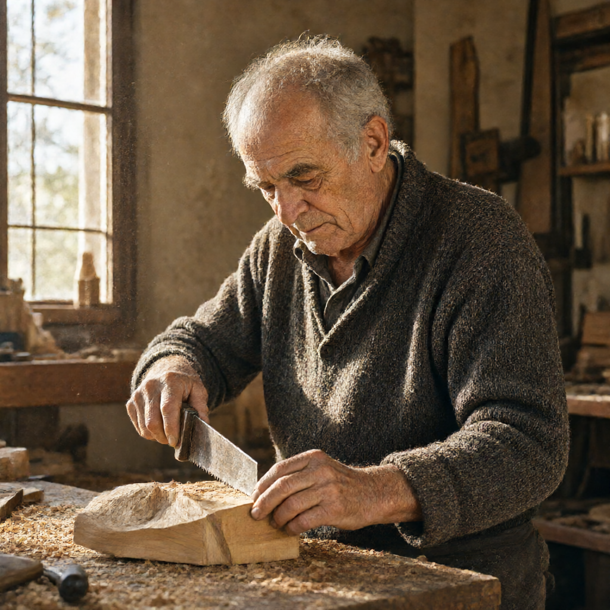
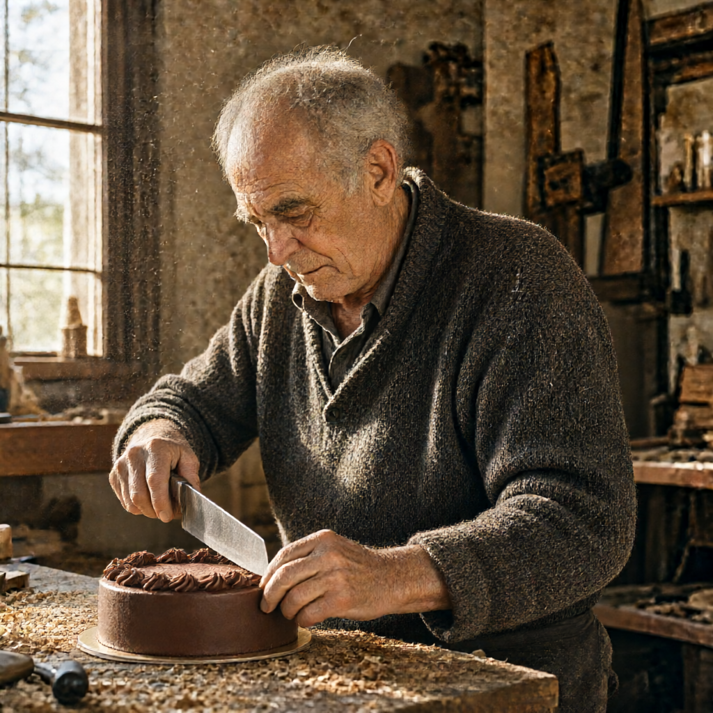
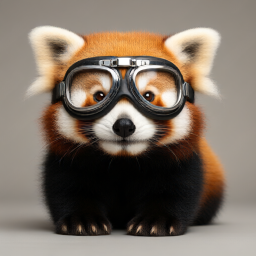
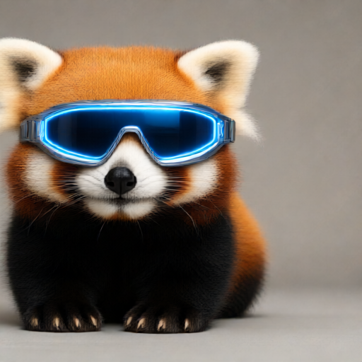

# Viggle Qwen-Image-2.1 Turbo (GGUF) - Standalone Runner

A standalone, ComfyUI-free environment for running **Viggle Qwen-Image-2.1 Turbo** and **Base Qwen-Image-2.1** GGUFs on **Apple Silicon (Metal)** and **Google Colab / Linux (NVIDIA CUDA)**.

Supports both **Text-to-Image** and **Image Editing** (Image-to-Image) with fully configurable Steps, CFG Scale, Negative Prompts, and Resolutions.

[](https://colab.research.google.com/github/samirpatil2000/vision-model/blob/main/colab_runner.ipynb)

---

## Showcase

### 1. Photorealistic Generation (1024×1024, 4 Steps)
<p align="center">
  
  <br />
  <em>"A raw 35mm photograph of an elderly craftsman carving wood in a sunlit workshop in Florence, fine skin wrinkles and realistic texture, natural silver hair, sawdust in the air, warm directional golden morning sunlight through dusty windows, shallow depth of field, 85mm f/1.4 portrait, photorealistic"</em>
</p>

### 2. High-Resolution Image Editing (1024×1024, 4 Steps)
<p align="center">
  
  &nbsp;&nbsp;&nbsp;&nbsp;
  
  <br />
  <em>Left: Original craftsman carving wood with a saw &nbsp;|&nbsp; Right: Edited — wooden block replaced with chocolate cake, saw replaced with a chef knife</em>
</p>

### 3. Object / Accessory Editing (Before vs After)
<p align="center">
  
  &nbsp;&nbsp;&nbsp;&nbsp;
  
  <br />
  <em>Left: Original ("a cute red panda with aviator goggles") &nbsp;|&nbsp; Right: Edited ("Change the aviator goggles to futuristic glowing blue sunglasses")</em>
</p>

---

## Architecture Overview

- **Diffusion Model**: [realrebelai/Viggle_Qwen-Image-2.1-Turbo_GGUFs](https://huggingface.co/realrebelai/Viggle_Qwen-Image-2.1-Turbo_GGUFs) (`Qwen-Image-2.1-viggle-turbo-Q4_K_M.gguf`, ~5.17 GB)
  - 4-step distilled FlowMatch DiT transformer fine-tuned by Viggle.
- **Text Encoder**: [Qwen/Qwen3-VL-8B-Instruct-GGUF](https://huggingface.co/Qwen/Qwen3-VL-8B-Instruct-GGUF) (`Qwen3VL-8B-Instruct-Q4_K_M.gguf`, ~4.68 GB)
  - Native Qwen3-VL multimodal text encoder.
- **Vision Projector (for Image Editing)**: [Qwen/Qwen3-VL-8B-Instruct-GGUF](https://huggingface.co/Qwen/Qwen3-VL-8B-Instruct-GGUF) (`mmproj-Qwen3VL-8B-Instruct-F16.gguf`, ~1.08 GB)
  - Multimodal projector encoding reference images for semantic image edits.
- **VAE**: [Comfy-Org/Qwen-Image-2.1](https://huggingface.co/Comfy-Org/Qwen-Image-2.1) (`qwen_image_2.1_vae_bf16.safetensors`, ~644 MB)
  - 4-channel RGBA VAE supporting native transparency.
- **Engine**: [leejet/stable-diffusion.cpp](https://github.com/leejet/stable-diffusion.cpp) compiled with `-DSD_METAL=ON` on macOS or `-DSD_CUDA=ON` on Linux/Colab.

---

## Quickstart

### 1. Build Engine
```bash
./setup.sh
```
*Auto-detects Apple Silicon Metal or NVIDIA CUDA (Colab/Linux) and compiles `stable-diffusion.cpp`.*

### 2. Download Weights
```bash
# Default: Viggle Turbo Q4_K_M (Fast 4-step)
./download_models.sh --turbo-q4

# Optional: Higher-fidelity Turbo Q8_0 (Near-lossless 4-step)
./download_models.sh --turbo-q8

# Optional: Full Base Model (For 30-50 steps with negative prompts & CFG)
./download_models.sh --base-q4
```

### 3. Generate Image (Text-to-Image)
```bash
# Default quick run (1024x1024, 4 steps)
./run_inference.sh "A photorealistic portrait of an old ceramic artisan in Kyoto" "./output/artisan.png"

# Full custom configuration:
STEPS=4 CFG=1.0 WIDTH=1024 HEIGHT=1024 SEED=42 ./run_inference.sh "A cyberpunk skyline at dusk" "./output/cyberpunk.png"
```

### 4. Edit Existing Image (Image-to-Image)
```bash
# Usage: ./edit_image.sh <input_image> <prompt> [output_image]
./edit_image.sh "./output/test_panda.png" "Change the aviator goggles to futuristic glowing blue sunglasses" "./output/edited_panda.png"
```

---

## Configuration Reference (Environment Variables)

All scripts accept dynamic environment variables:

| Variable | Default | Description | Example |
|---|---|---|---|
| `STEPS` | `4` | Denoising steps (use 4–8 for Turbo; 30–50 for Base) | `STEPS=8` |
| `CFG` | `1.0` | Guidance scale (1.0 for Turbo; 4.0–7.0 for Base) | `CFG=6.0` |
| `NEGATIVE_PROMPT` | `""` | Negative prompt guidance (used for Base model) | `NEGATIVE_PROMPT="blurry, distorted"` |
| `WIDTH` | `1024` | Width (must be divisible by 32: 512, 768, 1024, 1280) | `WIDTH=768` |
| `HEIGHT` | `1024` | Height (must be divisible by 32) | `HEIGHT=768` |
| `SEED` | `42` | Random number generator seed (`-1` for random) | `SEED=12345` |
| `MODEL` | Viggle Turbo Q4 | Custom path to any Qwen-Image GGUF model | `MODEL=./models/diffusion_models/Qwen-Image-2.1-Q4_K_M.gguf` |
| `SAMPLER` | `euler` | Sampling method (`euler`, `dpm++2m`, `heun`) | `SAMPLER=euler` |
| `SCHEDULE` | `simple` | Sigma scheduler (`simple`, `karras`, `exponential`) | `SCHEDULE=simple` |
| `FLASH_ATTN`| `false` | Enable Flash Attention in ggml | `FLASH_ATTN=true` |

---

## Turbo vs. Base Model Guide

| Mode | Steps | CFG Scale | Negative Prompt | Best Used For |
|---|---|---|---|---|
| **Viggle Turbo (Current)** | `4 – 8` | `1.0` (locked) | Ignored | Fast generation (~37s at 512px, ~2.1 min at 1024px), rapid prototyping, image editing. |
| **Base Qwen-Image-2.1** | `30 – 50` | `3.5 – 7.0` | Fully Supported | Maximum composition complexity, fine-grained negative guidance, high-precision text rendering. |

---

## Running on Google Colab

Open the included [`colab_runner.ipynb`](colab_runner.ipynb) in Google Colab with a GPU runtime (T4, L4, or A100):
1. The notebook automatically clones the repository and builds the engine with CUDA.
2. Form fields allow adjusting `steps`, `cfg_scale`, `width`, `height`, and `prompt` directly from sliders.
3. Outputs are displayed inline within the notebook.

---

## Speed Benchmarks (MacBook Pro Apple M5, 24 GB Unified Memory)

| Resolution | Total Latents | 4-Step Sampling Time | Total Run Time |
|---|---|---|---|
| **512 × 512** | 262,144 px | ~25.7s (~3.9s / step) | **~37 seconds** |
| **1024 × 1024** | 1,048,576 px | ~101.7s (~23.5s / step) | **~2.1 minutes** |
