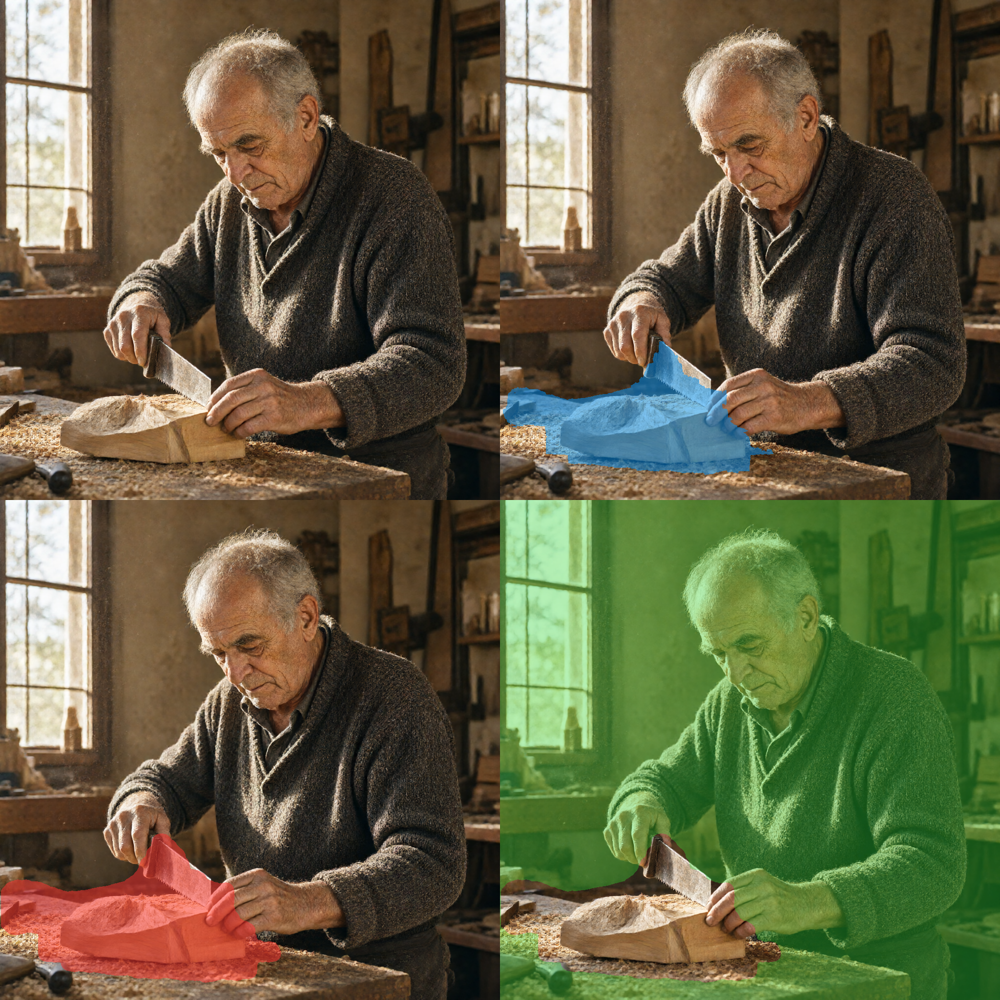
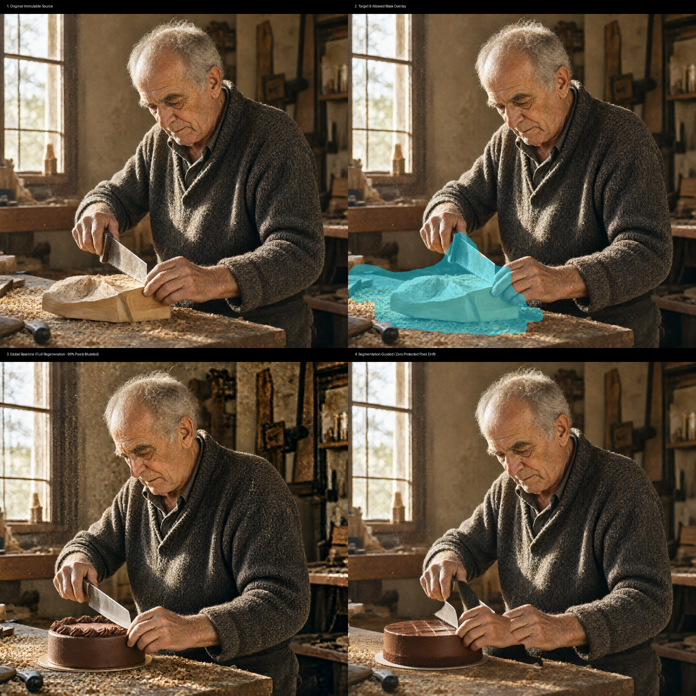

# Viggle Qwen-Image-2.1 Turbo (GGUF) - Standalone Runner & Segmentation-Aware Editor

A standalone, ComfyUI-free environment for running **Viggle Qwen-Image-2.1 Turbo** and **Base Qwen-Image-2.1** GGUFs on **Apple Silicon (Metal)** and **Google Colab / Linux (NVIDIA CUDA)**.

Supports **Text-to-Image**, **Global Image-to-Image**, and **Segmentation-Aware Pixel-Preserving Image Editing** with zero protected-pixel degradation.

| Notebook | Description | Launch in Colab |
| :--- | :--- | :---: |
| **Google Drive Edition (Zero-Download)** | Mounts Google Drive & loads existing weights directly without re-downloading | [](https://colab.research.google.com/github/samirpatil2000/vision-model/blob/main/colab_runner_drive.ipynb) |
| **Standard Edition (Auto-Download)** | Fresh standalone runner with one-click HuggingFace downloads | [](https://colab.research.google.com/github/samirpatil2000/vision-model/blob/main/colab_runner.ipynb) |

---

## Showcase

### 1. Segmentation-Aware Pixel-Preserving Image Editing (Zero-Drift Invariant)
<p align="center">
  
  <br />
  <em>Top-Left: Original Image (1024×1024) | Top-Right: Target Mask localized via text ("the hand saw and wooden block")<br />Bottom-Left: Allowed Edit Mask (Red) | Bottom-Right: Protected Pixels (Green - Bit-for-bit exact 0 pixel drift)</em>
</p>

<p align="center">
  
  <br />
  <em>Comparison: 1. Original Source &nbsp;|&nbsp; 2. Target/Allowed Overlay &nbsp;|&nbsp; 3. Global Baseline (99.95% pixels mutated across background) &nbsp;|&nbsp; 4. Segmentation-Guided Edit (Exact 0 protected pixel drift)</em>
</p>

### 2. Photorealistic Generation (1024×1024, 4 Steps)
<p align="center">
  
  <br />
  <em>"A raw 35mm photograph of an elderly craftsman carving wood in a sunlit workshop in Florence, fine skin wrinkles and realistic texture, natural silver hair, sawdust in the air, warm directional golden morning sunlight through dusty windows, shallow depth of field, 85mm f/1.4 portrait, photorealistic"</em>
</p>

### 3. Object / Accessory Editing (Before vs After)
<p align="center">
  
  &nbsp;&nbsp;&nbsp;&nbsp;
  
  <br />
  <em>Left: Original ("a cute red panda with aviator goggles") &nbsp;|&nbsp; Right: Edited ("Change the aviator goggles to futuristic glowing blue sunglasses")</em>
</p>

---

## Segmentation-Aware Pixel-Preserving Editing

Standard generative diffusion editing mutates pixels across the entire canvas—even in background walls, windows, hands, and clothes where no changes were requested. 

The **Segmentation-Aware Editor** solves this with a mathematically verified invariant:
$$\max_{(x,y) \in \text{Protected}} |O(x,y) - I(x,y)| \equiv 0$$
$$\text{changed\_protected\_pixels} \equiv 0$$

### Key Features
1. **Natural Language Localization**: Zero-shot target localization using CLIPSeg (`CIDAS/clipseg-rd64-refined`).
2. **Three-Mask Disentanglement**:
   - $M_{\text{target}}$: Raw semantic segmentation identifying the object.
   - $M_{\text{allowed}}$: Structurally dilated region authorizing boundary clearing and blending.
   - $M_{\text{protected}}$: Strict binary complement ($255 - M_{\text{allowed}}$) containing immutable original pixels.
3. **Resolution-Aware Context Cropper**: Snaps crops to multiples of 32 for Qwen-Image VAE compliance, preserves perspective and lighting context, and maps outputs back through invertible coordinate tracking.
4. **Strict Pixel Compositor**: Bit-for-bit copy of protected pixels with internal feathering strictly bounded within $M_{\text{allowed}}$.
5. **Sequential Memory Management**: Unloads segmentation models and purges PyTorch MPS memory cache before launching the diffusion DiT.

### Usage

#### Quickstart Bash Wrapper
```bash
# Full segmentation-aware edit
./edit_segmented.sh \
  "assets/realistic_craftsman.png" \
  "the hand saw and wooden block" \
  "Replace with a chef knife cutting a chocolate cake" \
  "output/segmented_craftsman.png"

# Fast preview mode (generates masks and diagnostic overlays without running generation)
PREVIEW=true ./edit_segmented.sh \
  "assets/realistic_craftsman.png" \
  "the hand saw and wooden block" \
  "Replace with a chef knife cutting a chocolate cake" \
  "output/preview.png"
```

#### Python CLI
```bash
python edit_segmented.py \
  --image assets/realistic_craftsman.png \
  --target "the hand saw and wooden block" \
  --instruction "Replace with a chef knife cutting a chocolate cake" \
  --output output/segmented_craftsman.png \
  --expand-pixels 16 \
  --feather-pixels 4 \
  --steps 4
```

---

## Preservation Benchmark

Tested on `assets/realistic_craftsman.png` (1024×1024, 1,048,576 pixels):

| Metric | Global Baseline (`edit_image.sh`) | Segmentation-Guided (`edit_segmented.py`) | Invariant Required |
| :--- | :---: | :---: | :---: |
| **Changed Protected Pixels** | `948,744` (99.95%) | **`0` (0.00%)** | `0` (Zero Tolerance) |
| **Max Error on Protected ($\Delta L_\infty$)** | `236` | **`0`** | `0` |
| **Mean Absolute Error (MAE)** | `22.4779` | **`0.0000`** | `0.0000` |
| **Protected MSE** | `1803.8621` | **`0.0000`** | `0.0000` |
| **Protected PSNR** | `15.57 dB` | **`Infinity (Exact Match)`** | `$\infty$` |
| **Allowed Region Edit MAE** | `39.89` | `45.88` | Semantic Modification |

Run the automated benchmark suite:
```bash
python benchmark_preservation.py
```

---

## Architectural Investigation: Native DiT Mask Conditioning

We evaluated integrating mask conditioning directly into the Qwen-Image 2.1 DiT weights:
1. **Current Engine Limitation**: `stable-diffusion.cpp` operates Qwen-Image in reference edit mode (visual tokens via Qwen3-VL vision projector). Inpainting concatenation is enabled only for Flux Fill / SDXL Inpaint.
2. **Channel Expansion Adapter Prototype**: In `src/architecture/mask_adapter.py`, we implemented a 33-channel patch projection adapter ($z_t \,\|\, z_{\text{masked}} \,\|\, M$) initialized with zero weights on new channels for identity preservation at step 0.
3. **The Preservation Theorem**: Because latent VAEs are lossy autoencoders ($\text{Dec}(\text{Enc}(I)) \neq I$, introducing $\Delta \approx 4-8$ across unchanged regions), **native latent inpainting can never guarantee exact pixel preservation ($L_\infty \equiv 0$) on its own**. The pixel compositor remains mathematically necessary.

To read the full technical analysis:
```bash
cat output/benchmarks/ARCHITECTURE_INVESTIGATION.md
python src/architecture/mask_adapter.py
```

---

## Architecture Overview

- **Diffusion Model**: [realrebelai/Viggle_Qwen-Image-2.1-Turbo_GGUFs](https://huggingface.co/realrebelai/Viggle_Qwen-Image-2.1-Turbo_GGUFs) (`Qwen-Image-2.1-viggle-turbo-Q4_K_M.gguf`, ~5.17 GB)
  - 4-step distilled FlowMatch DiT transformer fine-tuned by Viggle.
- **Text Encoder**: [Qwen/Qwen3-VL-8B-Instruct-GGUF](https://huggingface.co/Qwen/Qwen3-VL-8B-Instruct-GGUF) (`Qwen3VL-8B-Instruct-Q4_K_M.gguf`, ~4.68 GB)
  - Native Qwen3-VL multimodal text encoder.
- **Vision Projector (for Image Editing)**: [Qwen/Qwen3-VL-8B-Instruct-GGUF](https://huggingface.co/Qwen/Qwen3-VL-8B-Instruct-GGUF) (`mmproj-Qwen3VL-8B-Instruct-F16.gguf`, ~1.08 GB)
  - Multimodal projector encoding reference images for semantic image edits.
- **VAE**: [Comfy-Org/Qwen-Image-2.1](https://huggingface.co/Comfy-Org/Qwen-Image-2.1) (`qwen_image_2.1_vae_bf16.safetensors`, ~644 MB)
  - 4-channel RGBA VAE supporting native transparency.
- **Segmentation Subsystem**: `CIDAS/clipseg-rd64-refined` with MPS/CPU acceleration.
- **Engine**: [leejet/stable-diffusion.cpp](https://github.com/leejet/stable-diffusion.cpp) compiled with `-DSD_METAL=ON` on macOS or `-DSD_CUDA=ON` on Linux/Colab.

---

## Quickstart

### 1. Build Engine
```bash
./setup.sh
```
*Auto-detects Apple Silicon Metal or NVIDIA CUDA (Colab/Linux) and compiles `stable-diffusion.cpp`.*

### 2. Download Weights
```bash
# Default: Viggle Turbo Q4_K_M (Fast 4-step)
./download_models.sh --turbo-q4

# Optional: Higher-fidelity Turbo Q8_0 (Near-lossless 4-step)
./download_models.sh --turbo-q8

# Optional: Full Base Model (For 30-50 steps with negative prompts & CFG)
./download_models.sh --base-q4
```

### 3. Generate Image (Text-to-Image)
```bash
# Default quick run (1024x1024, 4 steps)
./run_inference.sh "A photorealistic portrait of an old ceramic artisan in Kyoto" "./output/artisan.png"

# Full custom configuration:
STEPS=4 CFG=1.0 WIDTH=1024 HEIGHT=1024 SEED=42 ./run_inference.sh "A cyberpunk skyline at dusk" "./output/cyberpunk.png"
```

### 4. Global Image Editing (Image-to-Image)
```bash
# Usage: ./edit_image.sh <input_image> <prompt> [output_image]
./edit_image.sh "./output/test_panda.png" "Change the aviator goggles to futuristic glowing blue sunglasses" "./output/edited_panda.png"
```

### 5. Automated Tests
```bash
python -m unittest discover tests
```
*Runs 19 deterministic unit and integration tests covering mask generation, compositing invariants, crop coordinates, format preservation, and architectural adapters.*

---

## Configuration Reference (Environment Variables)

All scripts accept dynamic environment variables:

| Variable | Default | Description | Example |
|---|---|---|---|
| `STEPS` | `4` | Denoising steps (use 4–8 for Turbo; 30–50 for Base) | `STEPS=8` |
| `CFG` | `1.0` | Guidance scale (1.0 for Turbo; 4.0–7.0 for Base) | `CFG=6.0` |
| `NEGATIVE_PROMPT` | `""` | Negative prompt guidance (used for Base model) | `NEGATIVE_PROMPT="blurry, distorted"` |
| `WIDTH` | `1024` | Width (must be divisible by 32: 512, 768, 1024, 1280) | `WIDTH=768` |
| `HEIGHT` | `1024` | Height (must be divisible by 32) | `HEIGHT=768` |
| `SEED` | `42` | Random number generator seed (`-1` for random) | `SEED=12345` |
| `EXPAND_PIXELS` | `16` | Dilation radius for allowed edit mask | `EXPAND_PIXELS=20` |
| `FEATHER_PIXELS`| `4` | Blending feather radius within allowed region | `FEATHER_PIXELS=6` |
| `MODEL` | Viggle Turbo Q4 | Custom path to any Qwen-Image GGUF model | `MODEL=./models/diffusion_models/Qwen-Image-2.1-Q4_K_M.gguf` |
| `SAMPLER` | `euler` | Sampling method (`euler`, `dpm++2m`, `heun`) | `SAMPLER=euler` |
| `SCHEDULE` | `simple` | Sigma scheduler (`simple`, `karras`, `exponential`) | `SCHEDULE=simple` |
| `FLASH_ATTN`| `false` | Enable Flash Attention in ggml | `FLASH_ATTN=true` |

---

## Running on Google Colab

Two dedicated notebooks are available depending on whether you want to load models from Google Drive or download them afresh:

### Option A: Google Drive Edition (Recommended — Zero Re-downloads)
If you already have model weights saved in Google Drive or want to avoid downloading ~11 GB on every Colab session:

[](https://colab.research.google.com/github/samirpatil2000/vision-model/blob/main/colab_runner_drive.ipynb) **[`colab_runner_drive.ipynb`](colab_runner_drive.ipynb)**

1. **Cell 3 (Mount Google Drive)**: Mounts `/content/drive` and symlinks your Drive models folder (defaults to `/content/drive/MyDrive/Colab Notebooks/Vision Models`) to `/content/vision-model/models`.
2. **Cell 4 (Strict Validation)**: Verifies that all required files exist on Google Drive and prints sizes. **No automatic downloads** are performed during inference runs.
3. **Cell 4b (First-Time Setup ONLY)**: If your Drive folder is empty, run this cell once to download the model weights (~11 GB) directly into your Google Drive folder. In all future Colab sessions, skip this step!
4. **Cells 5–7**: Runs Text-to-Image, Segmentation-Aware Editing, and Global Editing directly against the weights stored on Drive.

**Expected Google Drive Folder Layout:**
```
MyDrive/Colab Notebooks/Vision Models/
├── diffusion_models/
│   ├── Qwen-Image-2.1-Q4_K_M.gguf (Base) or Qwen-Image-2.1-viggle-turbo-Q4_K_M.gguf (Turbo)
├── text_encoders/
│   ├── Qwen3VL-8B-Instruct-Q4_K_M.gguf
│   └── mmproj-Qwen3VL-8B-Instruct-F16.gguf
└── vae/
    └── qwen_image_2.1_vae_bf16.safetensors
```

---

### Option B: Standard Edition (One-Click Auto-Download)
For fresh Colab environments without Google Drive storage:

[](https://colab.research.google.com/github/samirpatil2000/vision-model/blob/main/colab_runner.ipynb) **[`colab_runner.ipynb`](colab_runner.ipynb)**

1. **Step 2**: Auto-clones the repository, installs dependencies, and compiles `stable-diffusion.cpp` with CUDA.
2. **Step 3 (Model Selection)**: Downloads the **Full Base Model** (`--base-q4`, 30–50 steps) or **Viggle Turbo** (`--turbo-q4`, 4 steps) directly from HuggingFace.
3. **Step 5 (Segmentation-Aware Editing)**: 
   - Define the target region: `"the hand saw, wooden block, and hands"`.
   - Enter editing instruction: `"An elderly baker in a clean kitchen cleanly slicing a gourmet chocolate cake with a chef knife, natural hands"`.
   - Negative prompts: `"saw teeth, jagged blade, mangled hands, extra fingers, dirty table, wood shavings, cartoon, blurry"`.
   - Configure **30–40 steps** and **CFG 4.5**.
   - Inspect diagnostic mask overlays (`three_mask_panel.png`) and the pixel-preserved final output displayed inline.

